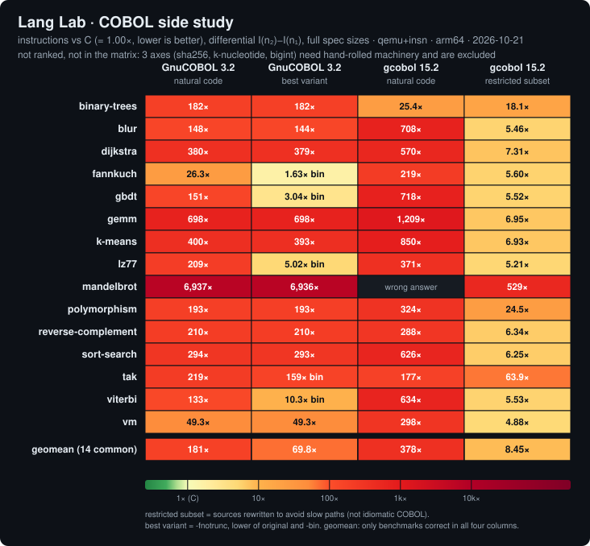

# COBOL side study

**Status: a side study, outside the ranking.** COBOL is not in `languages.json`, the matrix, the README
leaderboard or CI. Everything here is measured at the full size of each benchmark's own spec, with C
measured at the same sizes; nothing is extrapolated. Ratios are `COBOL differential / C differential`,
**lower is better**, C = 1.00.

The tables and the chart in this page are generated from `results/cobol/` by
`python3 scripts/make_cobol_chart.py --write` (never hand-edited); the data comes from
`scripts/cobol-study.sh`.

## What this measures, and what it does not

- It measures how many **guest instructions** the COBOL toolchains spend on 15 of the suite's 18 compute
  benchmarks, relative to C, with the same backend as the matrix (qemu-user + the TCG `insn` plugin,
  differential `I(n2) - I(n1)`, so process startup cancels).
- It is **not ranked and not comparable to the matrix geomean**: three axes are excluded because COBOL would
  have to hand-roll the missing machinery (sha256: bit operations; k-nucleotide: a hash map; bigint: a
  bignum), so any COBOL geomean covers a different, easier set of axes than the 18 the matrix ranks.
- It is **arm64 only** (the images carry the aarch64 qemu). Cross-ISA instruction counts are not comparable
  (see metric-validity Study 2), and no x86_64 COBOL data exists.
- It measures **compilers**, not the language: the same program text costs 1.6x to 7,000x C depending on which
  statements it uses and which compiler builds it. That spread is the finding.
- Instruction counts are blind to syscalls and to memory-system stalls; they are a proxy for work, validated
  against wall-clock for the matrix languages but never for COBOL.

## History

COBOL was in the matrix before the first release. It was **removed from the matrix in v0.1.0** because its
ratio (geomean about 460x C, up to about 223,000x on sha256) was dominated by hand-rolled emulation of machinery
the language lacks, and four of its cells were so slow that they had to be projected rather than measured, the
only non-measured numbers in the matrix. This study is the follow-up: it asks whether a modern, honestly written
COBOL can be measured **at full size on the benchmarks that need no emulation**, and what it costs.

It started as a pre-registered go/no-go gate for re-admission: **GO only if (a) at least 10 of the 15 benchmarks
are measurable at full spec size with C measured at the same size (no extrapolation), AND (b) for those,
callgrind attributes less than 50 percent of the instructions to the runtime's arithmetic helpers** (libcob's
decimal/GMP routines for GnuCOBOL). The verdict is in the gate section; the short form is that the answer
depends on whether the source is natural COBOL or a restricted subset, and it is not a matrix entry either way.

## Method

- **Backend.** Identical to the matrix: `scripts/measure.sh` under qemu-user with the TCG `insn` plugin, native
  checksum gate at both spec sizes first, then the guest instruction count at both sizes, differential
  `I(n2) - I(n1)`. N1, N2 and the expected checksums come from each `benchmarks/<b>/spec.json` through the
  `N1`/`N2`/`CHECK{1,2}_SUM` environment. COBOL compiles to a native ELF (GnuCOBOL via C, gcobol via GCC), so
  the counts are bit-exact; every cell is measured with at least two repetitions and records
  `determinism: exact`.
- **C at the same sizes.** The existing C image (`gcc:14`, `-O2`) is measured by the same script with the same
  spec sizes; every ratio divides by that cell. The C differentials are in the headline table.
- **A cell is a result only if it passes the checksum gate at both sizes.** A failing cell stays in the table as
  `wrong answer` / `no build`; it is never dropped silently.
- **Attribution is diagnostic, never the metric.** `valgrind --tool=callgrind` runs natively inside the same
  image at two reduced sizes (callgrind is about 50x slower) and the differential is attributed per shared
  object. `languages/cobol/tools/cg_attrib.py`, `languages/cobol/Dockerfile.diag`.

## The compilers (exact pins)

| Column key | Compiler | Pin |
|---|---|---|
| `gnucobol32` | GnuCOBOL 3.2.0 | GNU tarball `gnucobol-3.2.tar.xz`, sha256 `3bb48af46ced4779facf41fdc2ee60e4ccb86eaa99d010b36685315df39c2ee2` (GPG signature checked once against the GNU keyring, key `B9459D0CA8A740B323235CDF13E96B53C005604E`), built on `debian:bookworm-slim` (digest `sha256:96e378d7e6531ac9a15ad505478fcc2e69f371b10f5cdf87857c4b8188404716`, gcc 12.2.0, libgmp from bookworm), `--without-db --without-curses --without-xml2 --without-json` |
| `gnucobol32nt` | the same build | same image recipe with `COBC_FLAGS="-O2 -free -fnotrunc"` |
| `gcobol15` | gcobol 15.2.0 (GCC's COBOL front end) | `gcobol-15=15.2.0-16ubuntu1` on `ubuntu:26.04` (digest `sha256:c098726dd9b9733f3e885f8de0ef375206a311b0a317eadc40d347b1115fb944`, glibc 2.43) |
| `gcobol16` (secondary) | gcobol 16.2.0 | `gcobol-16=16.2.0-3` on `debian:forky-slim` (testing; the apt version is the pin) |
| `gnucobol4`, `gnucobol4nt` (secondary) | GnuCOBOL 4.0-early-dev.0 | `gnucobol4=4.0~early~20200606-7` on `debian:trixie-slim` (digest `sha256:4e401d95de7083948053197a9c3913343cd06b706bf15eb6a0c3ccd26f436a0e`) |
| C | gcc 14.3.0 | `gcc:14` (the matrix's C baseline) |

Flags (each Dockerfile logs the compiler version during the build and records `/app/COBC_VERSION` and
`/app/COBC_FLAGS`; every envelope carries both):

- GnuCOBOL: `cobc -x -O2 -free` (and `-fnotrunc` for the `nt` images).
- gcobol: `gcobol-N -O2 -fno-strict-aliasing -ffree-form -Wl,--export-dynamic`. `-fno-strict-aliasing` is
  needed because both gcobol 15.2 and 16.2 miscompile tight inline-arithmetic loops at plain `-O2` (see the
  findings below); `--export-dynamic` because libgcobol resolves CALL targets with `dlsym` against the
  executable's own symbols.
- Only flag names from `cobc --help` / `gcobol --help` inside the image were used. GnuCOBOL's `-fnotrunc`
  ("allow numeric field overflow") only drops a redundant truncation check for items without a PICTURE
  (`BINARY-LONG`, `BINARY-DOUBLE`, `COMP-5`); the checksum gate is the correctness proof for every cell that
  uses it.

The `gcobol` images apply a small, documented `sed` port to the **original** sources only (the `Dockerfile.gcobol`
"porting patches"): `ACCEPT FROM ARGUMENT-VALUE` becomes `ACCEPT FROM COMMAND-LINE` (gcobol returns argv[0]),
`MOVE NULL TO ptr` / `MOVE ptr TO ptr` become `SET` (gcobol rejects them), and a 19-digit `VALUE` picture is
widened. They change no algorithm and no hot statement.

## The source variants

| Variant | Files | What it is |
|---|---|---|
| **original / natural** | `languages/cobol/<bench>.cob` (15) | The straightforward COBOL port of the C reference: `COMPUTE`, `PIC S9(n) COMP-5` items, `FUNCTION MOD`, subscript expressions. What a COBOL programmer would write. |
| **bin** | `languages/cobol/<bench>-bin.cob` (fannkuch, gbdt, lz77, tak, viterbi) | COBOL 2002 `BINARY-LONG` / `BINARY-DOUBLE` items and single-verb `ADD` / `SUBTRACT` / `MOVE` instead of `COMPUTE`, so GnuCOBOL emits plain C for the hot statements. Still ordinary COBOL. |
| **restricted subset (`-gc`)** | `languages/cobol/gcobol/<bench>-gc.cob` (15) | Rewritten for gcobol 15.2's inline-arithmetic rules. **A diagnostic of what the compiler can do, not idiomatic COBOL:** it avoids the front end's slow library paths on purpose, and the natural-code columns sit next to it so the gap stays visible. |

The restricted-subset rules, as applied by the `-gc` files:

1. Every operand of a hot `ADD` / `SUBTRACT` / `MULTIPLY` / `DIVIDE` / `MOVE` / `IF` is a `BINARY-LONG` or
   `BINARY-DOUBLE` **variable**. Literals become named constants (`K-ONE`, `K-31`, ...), because a literal operand
   goes through libgcobol decimal-scaling helpers.
2. **No `COMPUTE` and no `FUNCTION`** in hot code. Arithmetic is single-operation `ADD`, `SUBTRACT`,
   `MULTIPLY ... GIVING`, `DIVIDE ... GIVING q REMAINDER r`; floor division and modulus use the `REMAINDER` form
   on non-negative operands (instead of `FUNCTION MOD`).
3. **No subscript expressions.** Every subscript is a plain variable; flat indices are built first with
   `MULTIPLY` / `ADD` or carried in running counters.
4. Tables are 1-based throughout (indices shifted by one where the C code is 0-based).
5. reverse-complement keeps bases as `BINARY-CHAR UNSIGNED` ASCII codes in a table instead of `PIC X`
   characters (integer compare and hash, no `FUNCTION ORD`).
6. **Dispatch** (polymorphism): each of the K=6 apply programs is resolved once into a `FUNCTION-POINTER` table
   (`SET PP(k) TO ENTRY "APPLYn"`, the vtable analogue) and the loop issues `CALL PP(type)` per object.
7. **Recursion** (tak, binary-trees): real `RECURSIVE` programs with `LOCAL-STORAGE` frames and real
   `ALLOCATE` / `FREE` per node. The self-call goes through a `FUNCTION-POINTER ... EXTERNAL` set once in the
   main program (gcobol 16.2 cannot link a literal-name self-CALL). Only the values that must survive the
   nested calls are `LOCAL-STORAGE` (each local costs a libgcobol push/pop per call); the decremented
   arguments are static `WORKING-STORAGE` items passed `BY CONTENT`.
8. **Floating point** (mandelbrot): `MOVE a TO c` then `SUBTRACT b FROM c` instead of `SUBTRACT b FROM a GIVING c`
   or a subtraction inside `COMPUTE`, which gcobol 15.2 miscompiles on floats.

What the variants never do: no manual stack replacing recursion, no arena or pool replacing `ALLOCATE`, no
hand-rolled dispatch table of `EVALUATE` branches. Each `-gc` header lists its remaining differences. A variant
that failed the gate at either spec size is not a result (the first mandelbrot draft is the example).

"Best variant" (GnuCOBOL column b) means: build with `-fnotrunc`, and per benchmark take the lower-instruction
correct source of {original, `-bin`} (only five benchmarks have a `-bin`). It is a selection among measured
cells, disclosed per row in the envelope (`alternatives`).

## Results

Ratio to C at the same full spec sizes (instructions, **lower is better**, C = 1.00), arm64, qemu+insn.
`wrong answer` = the program failed the checksum gate at a spec size (nothing is shown).



<!-- COBOL-HEADLINE:START -->
| Benchmark | GnuCOBOL 3.2 natural | GnuCOBOL 3.2 best variant | gcobol 15.2 natural | gcobol 15.2 restricted subset | C differential (instructions) |
|---|--:|--:|--:|--:|--:|
| binary-trees | 182.3 | 182.3 | 25.4 | 18.1 | 766,713,576 |
| blur | 148.3 | 144.4 | 708.0 | 5.5 | 36,423,925 |
| dijkstra | 379.5 | 379.2 | 570.0 | 7.3 | 16,568,479 |
| fannkuch | 26.3 | 1.6 (bin) | 219.3 | 5.6 | 82,845,142 |
| gbdt | 150.6 | 3.0 (bin) | 718.1 | 5.5 | 337,050,045 |
| gemm | 698.5 | 698.5 | 1,209 | 6.9 | 104,432,642 |
| k-means | 399.9 | 393.1 | 850.0 | 6.9 | 44,094,231 |
| lz77 | 209.3 | 5.0 (bin) | 371.1 | 5.2 | 34,175,172 |
| mandelbrot | 6,937 | 6,936 | *wrong answer* | 529.4 | 13,920,450 |
| polymorphism | 193.3 | 193.3 | 323.8 | 24.5 | 35,511,787 |
| reverse-complement | 210.1 | 210.1 | 288.1 | 6.3 | 11,250,179 |
| sort-search | 294.0 | 293.2 | 626.0 | 6.3 | 52,698,739 |
| tak | 219.2 | 159.3 (bin) | 176.8 | 63.9 | 49,017,477 |
| viterbi | 133.1 | 10.3 (bin) | 633.9 | 5.5 | 49,619,934 |
| vm | 49.3 | 49.3 | 298.3 | 4.9 | 164,400,000 |
| **geomean over the 14 benchmarks measured in all four columns** | **181.1** | **69.8** | **377.7** | **8.4** | |
| cells measured and correct (of 15) | 15 | 15 | 14 | 15 | |
<!-- COBOL-HEADLINE:END -->

Reading it:

- **Natural COBOL costs 25x to about 7,000x C on both compilers** (every benchmark, both columns). GnuCOBOL 3.2
  and gcobol 15.2 differ: gcobol 15.2 is worse on 12 of the 14 benchmarks where both are correct and better
  only on the two recursion-bound ones, tak and binary-trees. Natural mandelbrot is a wrong answer on gcobol
  15.2 (a compiler bug, see the findings).
- **GnuCOBOL 3.2's best variant** only gets near C where a `-bin` source exists (fannkuch, gbdt, lz77,
  viterbi), because `ADD` / `SUBTRACT` / `MOVE` on binary items is plain C there. Everything with `DIVIDE`,
  `FUNCTION MOD`, floats or subscript expressions still goes through the decimal machinery, and `-fnotrunc`
  alone changes little.
- **gcobol 15.2's restricted subset** is the only column near C on the integer loops (about 5x to 7x), but only
  with the rewrite rules above. The cells whose hot path is a CALL (tak, binary-trees, polymorphism) or a
  float operation (mandelbrot) stay far from C even there: that is the cost of libgcobol's call and float
  machinery, not of the program text.
- The geomean row covers only the benchmarks measured correctly in all four columns, so the columns share one
  set; it is **not comparable to the matrix geomean**.

### Secondary: gcobol 16 and GnuCOBOL 4.0-early-dev

Same sizes, same checksum gate, ratio to C (**lower is better**). Not headline columns: gcobol 16.2 is a testing
distribution pin and GnuCOBOL 4.0-early-dev is a 2020 snapshot.

<!-- COBOL-SECONDARY:START -->
| Benchmark | gcobol16-natural | gcobol16-restricted | gnucobol4-natural | gnucobol4-best |
|---|--:|--:|--:|--:|
| binary-trees | *no build* | 195.0 | 160.9 | 160.9 |
| blur | 565.2 | 5.6 | 59.1 | 54.8 |
| dijkstra | 450.1 | 6.7 | 365.7 | 365.1 |
| fannkuch | 67.0 | 5.8 | 18.8 | 1.6 |
| gbdt | 562.1 | 5.7 | 9.6 | 3.7 |
| gemm | 936.3 | 7.1 | 704.7 | 704.7 |
| k-means | 643.1 | 7.1 | 347.3 | 340.2 |
| lz77 | 317.3 | 5.4 | 244.0 | 5.4 |
| mandelbrot | 637.2 | 484.8 | 8019.5 | 8019.1 |
| polymorphism | 895.0 | 642.4 | 301.5 | 301.5 |
| reverse-complement | 205.8 | 5.8 | 225.7 | 225.7 |
| sort-search | 501.9 | 6.4 | 314.0 | 313.0 |
| tak | *no build* | 788.4 | 126.7 | 85.2 |
| viterbi | 481.9 | 5.7 | 88.9 | 11.9 |
| vm | 139.9 | 4.6 | 51.7 | 51.7 |
<!-- COBOL-SECONDARY:END -->

- **gcobol 16.2** gets the integer loops right at the same 4.6x to 7.1x C as 15.2 on the restricted sources, and gets
  the float subtraction right (the natural mandelbrot is correct, 637x C). But a `RECURSIVE` program cannot
  call itself by literal name (natural tak and binary-trees do not build), and its CALL path is roughly an
  order of magnitude more expensive than 15.2's: the restricted tak, binary-trees and polymorphism sources
  (built with the `FUNCTION-POINTER` workaround, which links on 16.2) cost about 12x, 11x and 26x what they
  cost on 15.2. It also hangs at plain `-O2` like 15.2 (strict-aliasing reproducer).
- **GnuCOBOL 4.0-early-dev** (a 2020 snapshot) keeps the fast-math path, so with `-fnotrunc` and the `-bin`
  sources fannkuch, lz77, gbdt and viterbi reach the same near-C range as GnuCOBOL 3.2's best variant; its
  natural code is still 10x to 8,000x C because `DIVIDE`, `FUNCTION MOD`, floats and subscript expressions
  stay on the decimal path.

## Where the instructions go (diagnostic)

Callgrind attribution of the differential, natively inside the image, at reduced sizes (percent of the
differential; the shares are size-independent once startup is subtracted). The sizes per row are in
`results/cobol/<date>-arm64-attribution.json`; gbdt (200 to 400) and vm (10,000 to 20,000) used smaller sizes
still for the natural sources because valgrind was killed at the standard pair. Diagnostic only; the metric above is
the qemu insn count.

<!-- COBOL-ATTRIB:START -->
Share of the differential instructions (percent; callgrind at reduced sizes, diagnostic only). **helper** = libcob decimal/GMP for GnuCOBOL, libgcobol for gcobol.

| Column | Benchmark | source | helper | other libcob | libc | of which dlsym | inline code |
|---|---|---|--:|--:|--:|--:|--:|
| GnuCOBOL 3.2 natural | binary-trees | binary-trees | 4.9 | 49.0 | 45.3 | 0.0 | 0.9 |
| GnuCOBOL 3.2 natural | blur | blur | 89.9 | 6.2 | 3.7 | 0.0 | 0.2 |
| GnuCOBOL 3.2 natural | dijkstra | dijkstra | 77.6 | 15.4 | 6.9 | 0.0 | 0.1 |
| GnuCOBOL 3.2 natural | fannkuch | fannkuch | 69.7 | 20.6 | 6.3 | 0.0 | 3.4 |
| GnuCOBOL 3.2 natural | gbdt | gbdt | 94.2 | 1.6 | 3.5 | 0.0 | 0.7 |
| GnuCOBOL 3.2 natural | gemm | gemm | 74.1 | 17.1 | 8.5 | 0.0 | 0.4 |
| GnuCOBOL 3.2 natural | k-means | k-means | 74.1 | 17.3 | 8.2 | 0.0 | 0.4 |
| GnuCOBOL 3.2 natural | lz77 | lz77 | 68.8 | 21.7 | 8.7 | 0.0 | 0.8 |
| GnuCOBOL 3.2 natural | mandelbrot | mandelbrot | 97.8 | 0.1 | 2.1 | 0.0 | 0.0 |
| GnuCOBOL 3.2 natural | polymorphism | polymorphism | 77.5 | 14.4 | 5.4 | 0.0 | 2.7 |
| GnuCOBOL 3.2 natural | reverse-complement | reverse-complement | 84.9 | 9.3 | 5.5 | 0.0 | 0.3 |
| GnuCOBOL 3.2 natural | sort-search | sort-search | 79.2 | 14.5 | 5.8 | 0.0 | 0.6 |
| GnuCOBOL 3.2 natural | tak | tak | 12.5 | 7.3 | 78.1 | 0.0 | 2.1 |
| GnuCOBOL 3.2 natural | viterbi | viterbi | 83.1 | 11.0 | 5.2 | 0.0 | 0.7 |
| GnuCOBOL 3.2 natural | vm | vm | 73.3 | 14.5 | 6.9 | 0.0 | 5.4 |
| GnuCOBOL 3.2 best variant | binary-trees | binary-trees | 4.9 | 49.0 | 45.3 | 0.0 | 0.9 |
| GnuCOBOL 3.2 best variant | blur | blur | 92.3 | 3.9 | 3.5 | 0.0 | 0.3 |
| GnuCOBOL 3.2 best variant | dijkstra | dijkstra | 77.6 | 15.3 | 6.9 | 0.0 | 0.1 |
| GnuCOBOL 3.2 best variant | fannkuch | fannkuch-bin | 0.0 | 0.0 | 11.9 | 0.0 | 88.1 |
| GnuCOBOL 3.2 best variant | gbdt | gbdt-bin | 60.6 | 2.4 | 1.5 | 0.0 | 35.5 |
| GnuCOBOL 3.2 best variant | gemm | gemm | 74.1 | 17.0 | 8.5 | 0.0 | 0.4 |
| GnuCOBOL 3.2 best variant | k-means | k-means | 75.4 | 16.1 | 8.1 | 0.0 | 0.4 |
| GnuCOBOL 3.2 best variant | lz77 | lz77-bin | 63.1 | 2.5 | 1.6 | 0.0 | 32.8 |
| GnuCOBOL 3.2 best variant | mandelbrot | mandelbrot | 97.8 | 0.1 | 2.1 | 0.0 | 0.0 |
| GnuCOBOL 3.2 best variant | polymorphism | polymorphism | 77.5 | 14.4 | 5.4 | 0.0 | 2.7 |
| GnuCOBOL 3.2 best variant | reverse-complement | reverse-complement | 84.9 | 9.3 | 5.5 | 0.0 | 0.3 |
| GnuCOBOL 3.2 best variant | sort-search | sort-search | 79.5 | 14.2 | 5.8 | 0.0 | 0.6 |
| GnuCOBOL 3.2 best variant | tak | tak-bin | 3.4 | 8.8 | 84.4 | 0.0 | 3.4 |
| GnuCOBOL 3.2 best variant | viterbi | viterbi-bin | 83.3 | 3.2 | 1.9 | 0.0 | 11.5 |
| GnuCOBOL 3.2 best variant | vm | vm | 73.3 | 14.5 | 6.9 | 0.0 | 5.4 |
| gcobol 15.2 natural | binary-trees | binary-trees | 80.0 | 0.0 | 14.5 | 0.0 | 5.5 |
| gcobol 15.2 natural | blur | blur | 79.9 | 0.0 | 11.9 | 0.0 | 8.2 |
| gcobol 15.2 natural | dijkstra | dijkstra | 87.1 | 0.0 | 10.1 | 0.0 | 2.8 |
| gcobol 15.2 natural | fannkuch | fannkuch | 88.4 | 0.0 | 9.9 | 0.0 | 1.8 |
| gcobol 15.2 natural | gbdt | gbdt | 89.5 | 0.0 | 10.1 | 0.0 | 0.4 |
| gcobol 15.2 natural | gemm | gemm | 90.0 | 0.0 | 9.9 | 0.0 | 0.1 |
| gcobol 15.2 natural | k-means | k-means | 90.2 | 0.0 | 9.7 | 0.0 | 0.1 |
| gcobol 15.2 natural | lz77 | lz77 | 88.8 | 0.0 | 9.0 | 0.0 | 2.3 |
| gcobol 15.2 natural | polymorphism | polymorphism | 55.7 | 0.0 | 41.4 | 15.5 | 3.0 |
| gcobol 15.2 natural | reverse-complement | reverse-complement | 87.7 | 0.0 | 9.6 | 0.0 | 2.6 |
| gcobol 15.2 natural | sort-search | sort-search | 85.3 | 0.0 | 8.1 | 0.0 | 6.6 |
| gcobol 15.2 natural | tak | tak | 86.4 | 0.0 | 8.6 | 0.0 | 4.9 |
| gcobol 15.2 natural | viterbi | viterbi | 89.1 | 0.0 | 10.0 | 0.0 | 0.9 |
| gcobol 15.2 natural | vm | vm | 86.7 | 0.0 | 9.8 | 0.0 | 3.5 |
| gcobol 15.2 restricted | binary-trees | binary-trees-gc | 73.3 | 0.0 | 18.7 | 0.0 | 8.0 |
| gcobol 15.2 restricted | blur | blur-gc | 0.0 | 0.0 | 0.0 | 0.0 | 100.0 |
| gcobol 15.2 restricted | dijkstra | dijkstra-gc | 18.4 | 0.0 | 0.0 | 0.0 | 81.6 |
| gcobol 15.2 restricted | fannkuch | fannkuch-gc | 0.0 | 0.0 | 0.0 | 0.0 | 100.0 |
| gcobol 15.2 restricted | gbdt | gbdt-gc | 0.3 | 0.0 | 0.0 | 0.0 | 99.7 |
| gcobol 15.2 restricted | gemm | gemm-gc | 3.0 | 0.0 | 0.0 | 0.0 | 97.0 |
| gcobol 15.2 restricted | k-means | k-means-gc | 0.0 | 0.0 | 0.0 | 0.0 | 100.0 |
| gcobol 15.2 restricted | lz77 | lz77-gc | 0.3 | 0.0 | 0.0 | 0.0 | 99.7 |
| gcobol 15.2 restricted | mandelbrot | mandelbrot-gc | 47.2 | 0.0 | 0.0 | 0.0 | 52.8 |
| gcobol 15.2 restricted | polymorphism | polymorphism-gc | 58.3 | 0.0 | 8.9 | 0.0 | 32.8 |
| gcobol 15.2 restricted | reverse-complement | reverse-complement-gc | 21.5 | 0.0 | 0.0 | 0.0 | 78.5 |
| gcobol 15.2 restricted | sort-search | sort-search-gc | 7.7 | 0.0 | 0.0 | 0.0 | 92.3 |
| gcobol 15.2 restricted | tak | tak-gc | 74.4 | 0.0 | 13.1 | 0.0 | 12.5 |
| gcobol 15.2 restricted | viterbi | viterbi-gc | 1.1 | 0.0 | 0.0 | 0.0 | 98.9 |
| gcobol 15.2 restricted | vm | vm-gc | 0.0 | 0.0 | 0.0 | 0.0 | 100.0 |
<!-- COBOL-ATTRIB:END -->

## The pre-registered gate and its verdict

Gate (fixed before the work): **GO** iff (a) at least 10 of the 15 benchmarks are measurable at full spec size
with C at the same size AND (b) for those, less than 50 percent of the instructions sit in the runtime's
arithmetic helpers. For GnuCOBOL the helper is libcob's decimal/GMP code (`cob_decimal_*`, `cob_add`/`cob_mul`/
`cob_div`, `cob_intr_*`, libgmp). For gcobol, which has no GMP, the analogue used here is **libgcobol** (its
`__gg__*` arithmetic and call helpers); that is a reinterpretation of the pre-registered text and is flagged as
such. A benchmark counts when it is measured correctly and under the limit; the count needed is 10.

<!-- COBOL-GATE:START -->
| Column | benchmarks measured and correct | with a callgrind profile | helper share < 50 percent | gate (at least 10 of 15) |
|---|--:|--:|--:|---|
| GnuCOBOL 3.2 natural | 15 | 15 | 2 | NO-GO |
| GnuCOBOL 3.2 best variant | 15 | 15 | 3 | NO-GO |
| gcobol 15.2 natural | 14 | 14 | 0 | NO-GO |
| gcobol 15.2 restricted | 15 | 15 | 12 | GO |
<!-- COBOL-GATE:END -->

### Verdict, in two parts

**1. Natural code: NO-GO on both compilers.** Part (a) holds (every benchmark is measurable at full size, with C at
the same size). Part (b) fails:

- **GnuCOBOL 3.2**: only 2 of 15 natural sources are under 50 percent in the decimal/GMP helpers (binary-trees
  and tak, and those two are dominated by libcob moves, allocation and libc instead); the other 13 sit at 69 to 98
  percent. The best variant passes 3 of 15 (the `-bin` sources of fannkuch and tak, plus binary-trees). The cause
  is structural: GnuCOBOL 3.x evaluates every `COMPUTE`, `MULTIPLY`, `DIVIDE` and `FUNCTION MOD` through
  `cob_decimal` (GMP); its fast-math path is `#if 0 /* TODO: merge of fast math */` in `cobc/typeck.c`, still so in
  the 3.3-dev nightly of 2026-10-19.
- **gcobol 15.2**: 0 of 14 correct natural cells pass (libgcobol is 56 to 90 percent of every one), and the
  mandelbrot original is a wrong answer. It has no GMP, but any literal operand, `COMPUTE`, `FUNCTION`,
  subscript expression, float operation or `CALL` goes to a `__gg__*` helper in libgcobol; only single-verb
  `ADD` / `SUBTRACT` / `MULTIPLY ... GIVING` / `DIVIDE ... GIVING ... REMAINDER` on `BINARY-LONG` /
  `BINARY-DOUBLE` variables is compiled inline.

**2. Restricted subset on gcobol 15.2: 12 of 15 under 50 percent, a mechanical GO at the 10-of-15 threshold, with
caveats that matter more than the count.**

- Eleven of the twelve are the pure integer-loop benchmarks (blur, dijkstra, fannkuch, gbdt, gemm, k-means,
  lz77, reverse-complement, sort-search, viterbi, vm): libgcobol is 0 to 22 percent of their instructions and
  they cost about 5x to 7x C. Even inline, gcobol's code is not C-speed (each variable access is a double
  indirection through the item descriptor).
- The twelfth is **mandelbrot-gc, at 47.2 percent, just under the line, and 529x C.** Every float operation is a
  libgcobol call; the caller-side argument marshalling is counted as inline code, so the helper share
  undercounts the library cost. It passes the letter of the gate, not its intent.
- The three that fail are exactly the three whose hot path is a `CALL`: **tak-gc 74 percent, binary-trees-gc 73
  percent, polymorphism-gc 58 percent** libgcobol. The CALL path (program-state push, module-name push,
  LOCAL-STORAGE push/pop, parameter marshalling) costs about 1,290 Ir per tak call (C: about 20) and about 580 Ir
  per polymorphism dispatch (C: about 24). The variants reduced it (tak 177x -> 64x, binary-trees 25x -> 18x
  against the natural code on gcobol; polymorphism fell from 153x to 24x once the per-dispatch `dlsym` lookup was
  replaced by a `FUNCTION-POINTER` table), but it stays above half of the instructions. Those axes measure the
  language's call mechanism, so this is the structural cost, not a coding mistake; no manual stack, arena or
  hand-rolled dispatch was substituted for it.
- The gate counts **where the instructions go, not how close to C the result is**. A GO at 12 of 15 on a
  restricted subset that is not idiomatic COBOL is not a claim that COBOL belongs in the ranking.

Neither part changes the decision: COBOL stays a side study. The numbers above are the answer to "what does a
modern COBOL cost at full size on the axes that need no emulation": 25x to 7,000x C when written naturally, about
5x to 7x C on integer loops only after rewriting the source to the compiler's inline subset, and tens to hundreds
of times C wherever calls or floats are on the hot path.

## Compiler findings

These were found while building the study and are kept as small reproducers in `languages/cobol/repro/`
(nothing has been reported upstream).

- **gcobol 15.2 and 16.2: strict-aliasing miscompile.** A Hoare partition scan over a `BINARY-LONG` table written
  with single-verb `ADD` / `SUBTRACT` / `MOVE` never terminates at plain `-O2` (the full sort-search-gc spins
  forever); it is correct at `-O0`, `-O1` and `-O2 -fno-strict-aliasing`. `repro/repro-strict-aliasing.cob`.
  Every gcobol cell in this study is built with `-fno-strict-aliasing`.
- **gcobol 15.2: float subtraction stores 0.** `SUBTRACT a FROM b GIVING c` on `FLOAT-LONG`/`COMP-2` items, and a
  subtraction inside a `COMPUTE` expression, give 0 (fixed in 16.2). This is why the natural `mandelbrot.cob`
  prints a wrong checksum (7402 instead of 6518 at n=128) on 15.2 and why `mandelbrot-gc` uses `MOVE` +
  `SUBTRACT ... FROM`. `repro/repro-float-subtract-giving.cob`.
- **gcobol 15.2: `BY VALUE` parameters are not reentrant in a `RECURSIVE` program** (wrong tak values, then a
  segfault), so the tak variant uses `BY REFERENCE` / `BY CONTENT`.
- **gcobol 15.2 has no option to cheapen CALL.** `--help` offers `-main` / `-no_main` and nothing about call
  conventions or static calls, so the per-call cost of the recursion-bound cells cannot be switched off.
- **gcobol 16.2: a `RECURSIVE` program cannot `CALL` itself by literal name** (`undefined reference to` the
  internal `fn.0` symbol); calling through a `FUNCTION-POINTER` links and runs. The 16.2 dynamic CALL path is also
  much slower than 15.2's (see the secondary table).
- **GnuCOBOL 3.x: the fast-math path is compiled out.** `cobc/typeck.c` carries `#if 0 /* TODO: merge of fast math */`,
  so every `COMPUTE`, `MULTIPLY`, `DIVIDE` and `FUNCTION MOD` is evaluated through `cob_decimal` (GMP). Only
  `ADD` / `SUBTRACT` of an integer into a binary item can go inline. The code is still disabled in the
  3.3-dev nightly of 2026-10-19 and there is no option that turns it on.
- **GnuCOBOL 4.0-early-dev** keeps the fast-math path on by default, but it applies only to `+ - *` and
  `MOVE`/compare on scalar `BINARY`/`COMP-5` items (and, with `-fnotrunc`, literal moves); `DIVIDE`,
  `FUNCTION MOD`, floating point and subscript expressions still go through `cob_decimal`.

## Reproduce

```sh
scripts/cobol-study.sh                  # builds the pinned images, measures the 4 headline columns + C
SECONDARY=1 scripts/cobol-study.sh      # + gcobol 16 and GnuCOBOL 4.0-early-dev
python3 languages/cobol/tools/cg_attrib.py results/cobol <date>   # callgrind attribution (diagnostic)
python3 scripts/make_cobol_chart.py --write                       # chart + the tables in this page
```

Dev runs: `RESDIR=/tmp/x BENCH="tak vm" IMAGES="gcobol15" scripts/cobol-study.sh` (never writes to
`results/cobol`). `RAWDIR=...` keeps the raw per-cell output; `SKIP_MEASURE=1 RAWDIR=...` re-assembles the
envelopes from it. Envelopes, one per column plus the C baseline, are `results/cobol/<date>-arm64-<column>.json`
(`gnucobol32-natural`, `gnucobol32-best`, `gcobol15-natural`, `gcobol15-restricted`, `c`, `secondary`,
`attribution`); each row records the source file, variant, compiler, version, flags, `i_n1`, `i_n2`,
differential, correctness status, the C differential and the ratio. A full headline run takes a few hours
(the 1,000x cells dominate), almost all of it in a handful of gcobol and GnuCOBOL natural-code cells.
